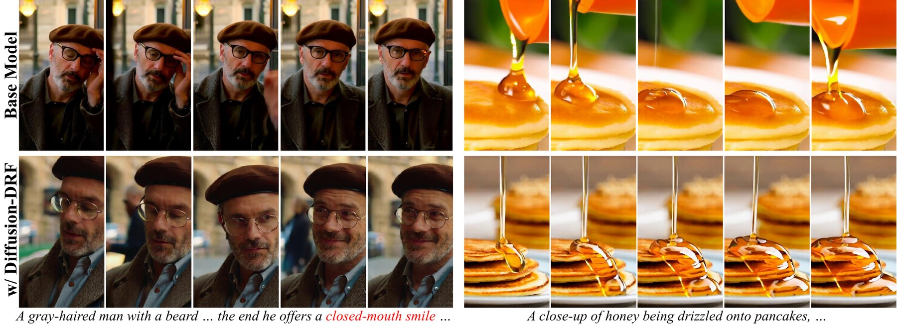
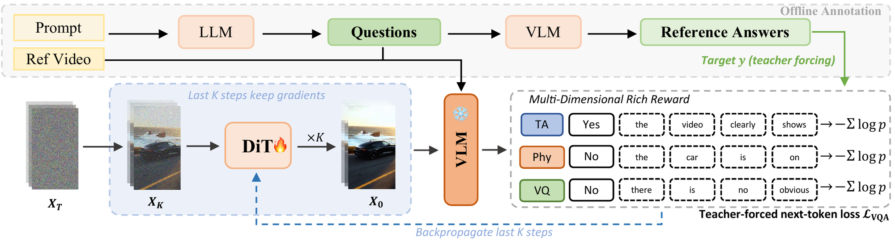

## Diffusion-DRF: Free, Rich, and Differentiable Reward for Video Diffusion Fine-Tuning

[](https://yfwang1999.github.io/Diffusion-DRF/)
[](https://arxiv.org/abs/2601.04153)
[](https://arxiv.org/abs/2601.04153)
[](LICENSE)



<sub>Wan2.1-1.3B before (top) and after (bottom) Diffusion-DRF fine-tuning, same prompt and seed. More videos on the [project page](https://yfwang1999.github.io/Diffusion-DRF/).</sub>

This repo is a **reimplementation** of Diffusion-DRF for Wan2.1-T2V: training code that fine-tunes the
generator with differentiable feedback from a frozen vision-language model (VLM), the annotation pipeline
that turns captions into structured queries, and the sampling script used for evaluation.

[⚙️ Setup](#setup) · [📦 Weights](#weights) · [🗂️ Data](#data) · [🏋️ Training](#training) · [🎬 Sampling](#sampling) · [📝 Annotation](#annotation-pipeline) · [📊 Evaluation](#evaluation) · [📚 BibTeX](#bibtex)

> [**Diffusion-DRF: Free, Rich, and Differentiable Reward for Video Diffusion Fine-Tuning**](https://arxiv.org/abs/2601.04153)<br>
> Yifan Wang, Yanyu Li, Gordon Guocheng Qian, Sergey Tulyakov, Yun Fu, Anil Kag
> <br>Northeastern University, Snap Inc.<br>
> NeurIPS 2026

Video diffusion alignment has relied on scalar rewards from reward models trained on human-preference
data, which are costly to build and give one coarse score per video, so generators learn to game them
and training collapses early. Diffusion-DRF (Differentiable Reward Flow) replaces the reward model with a
**frozen, off-the-shelf VLM**: each caption is decomposed into structured Yes/No questions with free-form
explanations on text&ndash;video alignment (TA), physical fidelity (Phy) and visual quality (VQ), and the
reward is the teacher-forced likelihood the VLM assigns to the reference answers given the generated video.
That likelihood is back-propagated through the VLM, the video decoder and the last K denoising steps into the
diffusion transformer. No reward model is trained and no preference data is collected. On Wan2.1-1.3B,
Diffusion-DRF reaches 55.38 on VBench-2.0, 2.39 points above the base model and 1.83 above the strongest
reward-tuning baseline, and keeps improving for 3K steps where scalar rewards collapse.



This repository contains:

* 🏋️ [Training](#training) of Wan2.1-T2V with the VLM reward (`scripts/train_drf.py`), multi-GPU via `torchrun`
* 🧠 [VLM rewards](videox_fun/reward/reward_fn.py) for Qwen2.5-VL and InternVL3 critics, plus the PickScore baseline
* 📝 [Annotation pipeline](#annotation-pipeline): caption decomposition and query construction (`annotation/`)
* 🎬 [Sampling](#sampling) with the evaluation settings of the paper (`inference/predict_t2v.py`)
* 📊 [Evaluation](#evaluation) notes and a helper for the VBench-2.0 file layout

> **Note.** This repository is a reimplementation of the paper's method. The H3AE decoder used in the
> paper is not available here, so the public **LightVAE** is used as a substitute in the reward path
> (see [Weights](#weights)). Results obtained with this code may differ from the numbers in the paper.


## Setup

```bash
git clone https://github.com/YFWang1999/Diffusion-DRF.git
cd Diffusion-DRF
# install the PyTorch build matching your CUDA version first, then
pip install -r requirements.txt
pip install flash-attn --no-build-isolation   # optional, speeds up the VLM
```

The code was developed with `transformers==4.57`; the differentiable video path through the Qwen2.5-VL
processor depends on that version's video processor. Tested with Python 3.10&ndash;3.12 and PyTorch 2.5&ndash;2.10.


## Weights

All models are public; nothing is trained except the diffusion transformer.

| Role | Model | Download |
|---|---|---|
| Generator (trained) | Wan2.1-T2V-1.3B, original layout | [`Wan-AI/Wan2.1-T2V-1.3B`](https://huggingface.co/Wan-AI/Wan2.1-T2V-1.3B) |
| Critic (frozen) | Qwen2.5-VL-7B-Instruct (3B and InternVL3-1B also supported) | [`Qwen/Qwen2.5-VL-7B-Instruct`](https://huggingface.co/Qwen/Qwen2.5-VL-7B-Instruct) |
| Reward-path decoder (frozen) | LightVAE for Wan2.1, `lightvaew2_1.safetensors` | [`lightx2v/Autoencoders`](https://huggingface.co/lightx2v/Autoencoders) |

```bash
huggingface-cli download Wan-AI/Wan2.1-T2V-1.3B --local-dir models/Wan2.1-T2V-1.3B
huggingface-cli download lightx2v/Autoencoders lightvaew2_1.safetensors --local-dir models
```

**Reward-path decoder.** Decoding 49 frames with gradients through the official Wan2.1 VAE is very memory
hungry. The paper uses a lightweight H3AE decoder in the reward path; this reimplementation uses LightVAE, a
channel-pruned Wan2.1 VAE that shares its latent space and loads into the same model class. On a 512&times;288,
49-frame clip, decoding plus back-propagation takes about 14.5&nbsp;GB with LightVAE, while the official VAE
does not fit on a 48&nbsp;GB GPU. Pass `--reward_decoder wan` to use the official VAE anyway. Sampling at
inference time always uses the official VAE.


## Data

Training needs captioned real videos and an annotation file with one structured query per row: the caption is
the generation prompt, and the paired real video serves only as the reference clip of the Phy and VQ queries.
The format and the annotations used by this reimplementation (10,982 OpenVid-1M videos, 45,971 queries) are
described in [`data/README.md`](data/README.md); [`data/example_annotations.tsv`](data/example_annotations.tsv)
shows the format on four videos. To annotate your own videos, see [Annotation pipeline](#annotation-pipeline).


## Training

```bash
MODEL_DIR=models/Wan2.1-T2V-1.3B \
VLM_PATH=Qwen/Qwen2.5-VL-7B-Instruct \
DECODER_PATH=models/lightvaew2_1.safetensors \
DATA_PATH=data/drf_train_annotations.tsv \
VIDEO_ROOT=data/videos \
bash scripts/train_drf.sh
```

[`scripts/train_drf.sh`](scripts/train_drf.sh) follows the main setting of the paper and launches
`scripts/train_drf.py` on every visible GPU with one sample per GPU. Checkpoints are written every 500 steps to
`<output_dir>/checkpoint-<step>/transformer/`; the paper reports the checkpoint at step 1500. Training samples
and the critic's predictions are saved every 10 steps under `<output_dir>/train_samples/` for inspection.

<details>
<summary>Recipe (<code>scripts/train_drf.sh</code>)</summary>

| Setting | Value |
|---|---|
| Rollout | 512&times;288, 49 frames, 25 denoising steps, classifier-free guidance 6.0, shift 5 |
| Back-propagation | through the last 3 denoising steps (`--backprop_strategy tail --backprop_num_steps 3`), stop-gradient before |
| Critic input | `N_f = 10` uniformly sampled generated frames, plus 10 reference frames for Phy queries and 1 for VQ |
| Queries | one TA or Phy query per step from the annotation file, plus the fixed VQ query (`--mix_loss`) |
| Loss | mean next-token NLL over all answer tokens (decision + explanation), teacher forced |
| Optimizer | AdamW, lr 1e-5, weight decay 3e-2, eps 1e-10, gradient clip 50 |
| Batch | 1 per GPU; the paper used 16 A100-80GB, i.e. effective batch 16 |
| Memory savers | activation checkpointing in the DiT, frame subsampling, LightVAE in the reward path |

</details>

<details>
<summary>Smaller GPUs</summary>

The paper's setting was run on 80&nbsp;GB GPUs. To fit smaller cards, in order of effect: use a smaller critic
(`--vlm_path Qwen/Qwen2.5-VL-3B-Instruct`), lower `--max_frame_pixels` (e.g. 16384), reduce `--num_frames`
and `--ref_frames_num_phy`, reduce `--backprop_num_steps`, and add `--low_vram` to park the text encoder on
the CPU. Fewer GPUs can be compensated with `--gradient_accumulation_steps`. A reduced setting
(Qwen2.5-VL-3B, `N_f = 4`, 16K pixels per frame, 1 back-propagated step) runs on a 48&nbsp;GB GPU.

</details>

<details>
<summary>Ablations and baselines</summary>

| Variant | Flag |
|---|---|
| Binary question only (no explanation) | `--binary_answer` |
| Scalar logit-level reward, as in Vanilla-DRF | `--yes_token_only` |
| InternVL3 critic | `--reward_fn InternVLReward --vlm_path OpenGVLab/InternVL3-1B` |
| PickScore baseline | `--reward_fn PickScoreReward`, see [`scripts/train_pickscore.sh`](scripts/train_pickscore.sh) |
| Single-prompt tuning | `--seed N` with a one-video annotation file, fixes the initial noise across steps |
| Fewer / more back-propagated steps | `--backprop_num_steps K` |

</details>


## Sampling

```bash
python inference/predict_t2v.py \
  --model_dir models/Wan2.1-T2V-1.3B \
  --transformer_path output/drf_wan1.3b_qwen7b/checkpoint-1500/transformer/diffusion_pytorch_model.safetensors \
  --prompt_file prompts.txt \
  --save_dir samples/drf
```

Omit `--transformer_path` to sample from the base model. One video is written per line of the prompt file as
`<save_dir>/<8-digit index>.mp4`. The defaults are the evaluation settings of the paper: 512&times;288,
49 frames, 30 steps, guidance 6.0, shift 3 and TeaCache with threshold 0.10. `--seed -1` draws fresh noise
for every video.


## Annotation pipeline

```bash
cd annotation
# 1. decompose captions into atomic scene elements with a text-only LLM
python decompose_captions.py --captions captions.tsv --output_json decompositions.json
# 2. build TA/Phy queries and answer the TA queries on the real videos with the VLM
python build_annotations.py --captions captions.tsv --decompositions decompositions.json \
  --video_root /path/to/videos --output ../data/my_annotations.tsv
```

`captions.tsv` is tab-separated with the columns `video_id`, `real_video_path`, `prompt`. The question
templates are in [`annotation/prompts.py`](annotation/prompts.py); the VQ query is fixed and lives next to the
reward in [`videox_fun/reward/reward_fn.py`](videox_fun/reward/reward_fn.py). Both scripts accept
`--num_shards/--shard_index` to spread the work over several GPUs.


## Evaluation

The paper evaluates on [VBench-2.0](https://github.com/Vchitect/VBench) and the
[VideoGen-Eval](https://github.com/AILab-CVC/VideoGen-Eval) prompt set; see
[`evaluation/README.md`](evaluation/README.md) for the protocol and
[`evaluation/rename_for_vbench2.py`](evaluation/rename_for_vbench2.py) for the VBench-2.0 file layout.

VBench-2.0 results **reported in the paper** (Wan2.1-1.3B, all methods trained on the same data; this
reimplementation has not been re-scored):

| Method | Overall | Creativity | Common Sense | Controllability | Human Fidelity | Physics |
|---|:-:|:-:|:-:|:-:|:-:|:-:|
| Wan2.1-1.3B-T2V (base) | 52.99 | 53.79 | 55.52 | 26.59 | 80.65 | 48.40 |
| Flow-DPO | 50.27 | 46.77 | 50.28 | 27.76 | 71.76 | 54.78 |
| Flow-GRPO | 50.64 | 44.71 | 50.85 | 25.48 | 77.80 | 54.37 |
| PickScore | 49.62 | 35.97 | 55.23 | 23.88 | **81.89** | 51.13 |
| VideoAlign | 53.55 | 49.64 | 56.09 | 26.32 | 81.43 | 54.26 |
| Vanilla-DRF (7B) | 53.70 | 52.70 | 54.66 | 26.64 | 78.55 | 55.61 |
| Diffusion-DRF (InternVL3-1B) | 53.10 | 50.85 | 56.90 | 24.33 | 77.31 | 56.21 |
| Diffusion-DRF (Qwen2.5-VL-3B) | 53.72 | 53.93 | **57.53** | 25.95 | 76.74 | 54.42 |
| **Diffusion-DRF (Qwen2.5-VL-7B)** | **55.38** | **54.58** | 56.96 | **27.98** | 80.51 | **56.85** |


## Repository layout

```
scripts/train_drf.py          training loop: rollout, truncated back-propagation, reward
scripts/train_drf.sh          main setting; scripts/train_pickscore.sh: PickScore baseline
videox_fun/reward/            VLM rewards (Qwen2.5-VL, InternVL3) and PickScore
videox_fun/{models,pipeline}  Wan2.1 transformer, VAE, text encoder and sampling pipeline
annotation/                   caption decomposition and query construction
inference/predict_t2v.py      sampling
evaluation/                   benchmark notes and the VBench-2.0 rename helper
config/wan2.1/                model configuration
```


## BibTeX

```bibtex
@inproceedings{wang2026diffusiondrf,
  title     = {Diffusion-DRF: Free, Rich, and Differentiable Reward for Video Diffusion Fine-Tuning},
  author    = {Wang, Yifan and Li, Yanyu and Qian, Gordon Guocheng and Tulyakov, Sergey and Fu, Yun and Kag, Anil},
  booktitle = {Advances in Neural Information Processing Systems (NeurIPS)},
  year      = {2026}
}
```


## Acknowledgments

This code builds on [VideoX-Fun](https://github.com/aigc-apps/VideoX-Fun) (Apache License 2.0); the files
under `videox_fun/` are adapted from it. It also relies on [Wan2.1](https://github.com/Wan-Video/Wan2.1),
[Qwen2.5-VL](https://github.com/QwenLM/Qwen2.5-VL), [InternVL](https://github.com/OpenGVLab/InternVL),
[LightX2V](https://github.com/ModelTC/LightX2V) and [TeaCache](https://github.com/ali-vilab/TeaCache).
The code is released under the Apache License 2.0, see [`LICENSE`](LICENSE); model weights and datasets are
subject to their own licenses.
